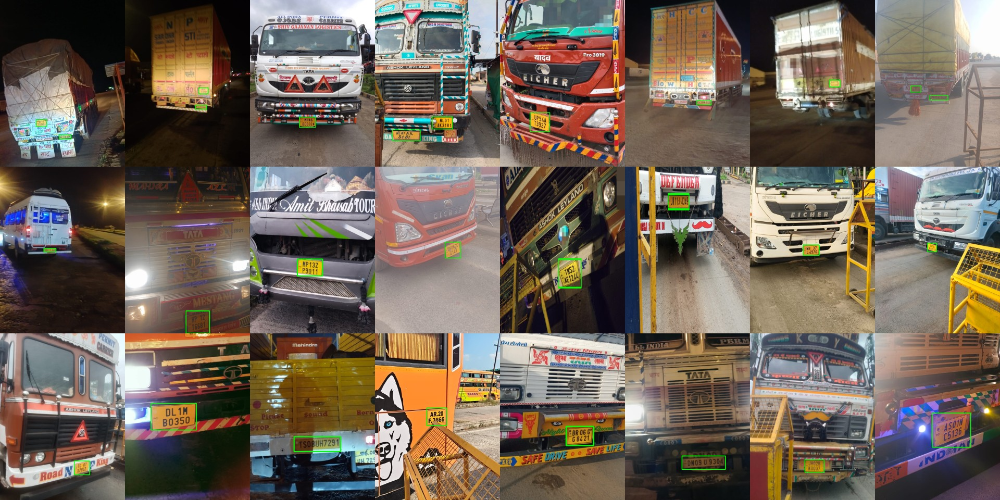

# Indian Truck License Plates (LPD+LPR) Sample



[](https://creativecommons.org/licenses/by-nc/4.0/)
[](https://witvix.com)

Real-world photos of Indian commercial vehicles -- mostly trucks, plus some buses and vans --
taken on handheld phones at logistics-yard gates, by day and at night. Every image is annotated
for **license plate detection (LPD)** with bounding boxes and **license plate recognition (LPR)**
with the plate text.

This is a free sample of a larger commercial dataset; see [Full dataset](#full-dataset).

## Download

Get `witvix-indian-truck-plates-sample-v1.zip` (131 MB) from
[Releases](https://github.com/witvix/indian-truck-license-plates/releases), then:

```bash
unzip witvix-indian-truck-plates-sample-v1.zip
pip install opencv-python pandas
python examples/show_samples.py indian-truck-license-plates-sample
```

The file list below is the inside of the zip.

## At a glance

| | |
|---|---|
| Images | 470 |
| Plate boxes, each with its text | 589 |
| Unique vehicles | 470 (one photo per vehicle) |
| State / UT registration codes | 29 |
| Night photos | 43% |
| Photos with 2+ plates | 25% |
| Two-line plates | 69% of plates |
| Small plates (< 50 px tall) / large (>= 150 px) | 21% / 20% |
| Most common resolutions | 1200×1600 (132), 899×1599 (36), 574×1280 (33) |
| Captured | Aug-Sep 2026 |

## Files

```
images/<id>.jpg           photos
labels/<id>.txt           YOLO boxes: "0 cx cy w h" (normalized), class 0 = license_plate
data.yaml                 YOLO dataset file
annotations_coco.json     the same boxes in COCO format, plate text in "attributes"
plates/<id>_<k>.jpg       plate crops for recognition (box + 5% margin)
plates.csv                one row per plate
metadata.csv              one row per image
```

`plates.csv` columns: `image`, `plate_index`, `crop`, `x_min`, `y_min`, `x_max`, `y_max` (pixels),
`plate_text` (registration number, no spaces, top line first on two-line plates), `state_code`,
`layout` (`single_line` / `two_line`).

`metadata.csv` columns: `image`, `width`, `height`, `n_plates`, `state_codes`, `light` (`day` / `night`).

## How the labels were made

- **Boxes** come from our plate detector. A photo is included only if every box in it is confirmed as a
  plate by the text readers, and a second, low-threshold detector pass found no further plate -- so no
  plate in an image is left unlabeled.
- **Text** is accepted only when 5 independent readings (3 recognition models, 2 re-crops) agree on a
  valid Indian registration number, or at least 3 of them agree and match a confident reading of the same
  vehicle in another photo, or a reviewer confirmed it. 341 of 589 plates (58%)
  were checked by a person. Plates nobody can read are left out of this sample.
- One photo per vehicle, and near-duplicate photos are removed (perceptual hash).

## Privacy

Faces and phone-camera watermarks / date stamps were blurred automatically (best effort -- please
tell us if you spot one we missed), all EXIF and file metadata is removed, and file names carry no
time or place. Registration numbers are kept because they are the labels. Do not use this dataset
to identify, track or contact vehicle owners.

## Registration state / UT

| Code | State / UT | Images |
|---|---|---|
| RJ | Rajasthan | 41 |
| HR | Haryana | 41 |
| MH | Maharashtra | 40 |
| NL | Nagaland | 38 |
| UP | Uttar Pradesh | 32 |
| KA | Karnataka | 28 |
| GJ | Gujarat | 27 |
| PB | Punjab | 25 |
| DD | Dadra & Nagar Haveli and Daman & Diu | 22 |
| HP | Himachal Pradesh | 18 |
| MP | Madhya Pradesh | 17 |
| UK | Uttarakhand | 17 |
| TN | Tamil Nadu | 17 |
| JK | Jammu & Kashmir | 11 |
| WB | West Bengal | 10 |
| CG | Chhattisgarh | 9 |
| TG | Telangana | 9 |
| DL | Delhi | 9 |
| TS | Telangana (old code) | 8 |
| AR | Arunachal Pradesh | 7 |
| BR | Bihar | 7 |
| DN | Dadra & Nagar Haveli (old code) | 7 |
| JH | Jharkhand | 6 |
| AS | Assam | 5 |
| CH | Chandigarh | 5 |
| KL | Kerala | 5 |
| AP | Andhra Pradesh | 5 |
| GA | Goa | 3 |
| PY | Puducherry | 1 |

## Known limitations

- Mostly trucks with yellow commercial plates; few private cars, no two-wheelers.
- Plates nobody can read are excluded from this sample (the full dataset labels them as unreadable).
- Boxes are axis-aligned rectangles, not plate corners.
- 42% of plate texts rely on model agreement without a human check; tell us about any error.
- Sample only, with no train/val/test split; don't use it as a benchmark.

## Quick start

```python
import pandas as pd, cv2

plates = pd.read_csv("indian-truck-license-plates-sample/plates.csv")
for row in plates.head(3).itertuples():
    img = cv2.imread(f"indian-truck-license-plates-sample/images/{row.image}")
    cv2.rectangle(img, (row.x_min, row.y_min), (row.x_max, row.y_max), (0, 255, 0), 2)
    print(row.image, row.plate_text, row.state_code, row.layout)
```

YOLO (Ultralytics): `yolo detect train data=data.yaml model=yolo11n.pt`

## License

[CC BY-NC 4.0](https://creativecommons.org/licenses/by-nc/4.0/): free for research and other non-commercial use with attribution. Commercial use needs a license; see below.

## Citation

```bibtex
@misc{witvix_truck_plates_sample_2026,
  title  = {Indian Truck License Plates (LPD+LPR) Sample},
  author = {Witvix},
  year   = {2026},
  note   = {470 images, 589 annotated plates}
}
```

## Full dataset

A larger commercial dataset from Witvix -- same sources, labelling and privacy process, plus unreadable-plate labels and a vehicle-disjoint train / val / test split, growing every month -- is available for licensing. For the current size and pricing, email **connect@witvix.com**.
